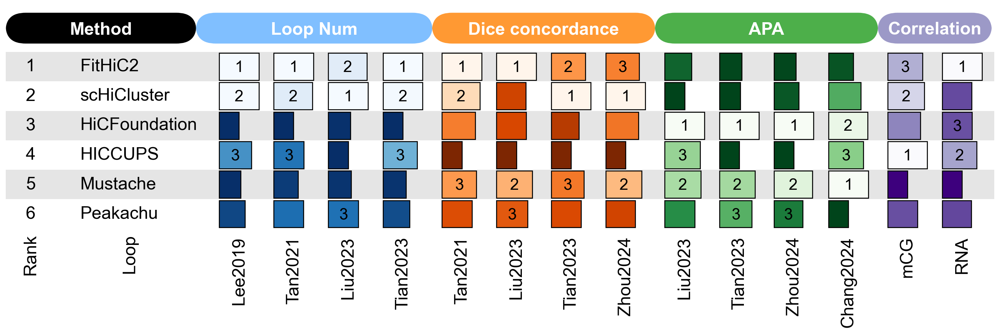
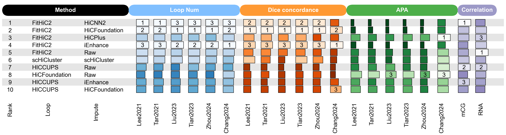

# Single-cell Hi-C workflow tutorials — public test

**[Read the tutorial website](https://rawandy2001-design.github.io/benchmark-tutorials/)**

This website presents the analysis workflows accompanying our single-cell Hi-C
benchmark. It covers data preparation, cell embeddings, A/B compartments,
domains/TADs and chromatin loops. The tutorials combine brief explanations,
command examples and saved results, including the steps used to generate the
loop-workflow comparison figures.

## Selected figures

### Native loop workflows (Fig. 5g)

Six native loop-calling workflows ranked using the five-component min–max score.
The components are loop num, mapped-reference Dice concordance, APA P2LL,
mCG correlation and RNA correlation.

### Caller–input workflows (Fig. 6d)

The ten highest-scoring workflows from the full comparison of 25 caller–input
combinations, including raw and imputed inputs.

